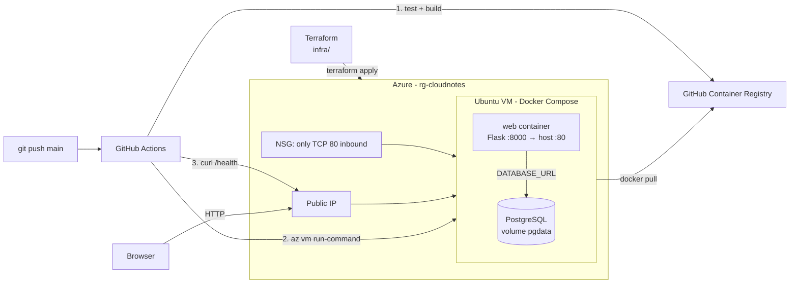

# Cloud Notes — Cloud-Native Application Deployment

A small notes web application (Flask + PostgreSQL) deployed on an **Azure VM** with
**Terraform** (IaC) and **GitHub Actions** (CI/CD).

**Flow:** Provision (Terraform) → Deploy (Docker Compose on VM) → Automate (GitHub Actions)

## 1. Application overview

| Component | Technology | Role |
|---|---|---|
| Web app | Python Flask + gunicorn, in a Docker container | Server-rendered page: add / list / delete notes, `/health` endpoint |
| Database | PostgreSQL 16 container | Stores notes in table `notes` |
| Persistence | Docker named volume `pgdata` | Data survives container restarts and redeployments |
| Configuration | Env variables `DATABASE_URL`, `POSTGRES_PASSWORD`, `WEB_IMAGE` | Supplied by `.env` on the VM (never in Git) |

The web container talks to the database over the internal Docker network (`db:5432`).
The database port is **not published**, so it is not reachable from the internet.

## 2. Architecture



## 3. Design decisions

- **VM instead of PaaS:** cheapest option for student credits (one B1s VM), and it shows
  clearly what we manage ourselves (OS, Docker, database container, backups) versus what
  Azure manages (physical hardware, network, hypervisor, VM availability).
- **PostgreSQL in a container with a named volume:** simple and cheap. Trade-off: no
  managed backups/high availability (a managed Azure Database for PostgreSQL would provide them).
- **Deployment without SSH:** port 22 is closed. GitHub Actions uses an Azure service principal
  (limited to the resource group) and `az vm run-command` through the Azure API.
- **Secrets:** DB password generated by Terraform (`random_password`) and written to
  `/opt/cloudnotes/.env` (mode 600) by cloud-init. Azure credentials are a GitHub secret.
  The registry token is the temporary `GITHUB_TOKEN`. Nothing secret is in Git.

| Managed by me | Managed by Azure |
|---|---|
| Ubuntu OS, Docker, app container, PostgreSQL container, data volume, deploy scripts | Datacenter, hardware, hypervisor, virtual network, public IP, NSG enforcement |

## 4. Repository structure

```
app/                 Flask application, Dockerfile, tests
compose.yaml         web + db services, persistent volume
infra/               Terraform (VM, network, NSG, public IP, cloud-init)
scripts/             deploy script executed on the VM
.github/workflows/    CI/CD pipeline
```

## 5. One-time prerequisites

1. Azure subscription (e.g. Azure for Students), GitHub account.
2. Installed locally: Git, Azure CLI, Terraform ≥ 1.5 (Docker Desktop optional for local tests).
3. Log in: `az login` then `az account set --subscription "<subscription-id>"`.
4. `cp infra/terraform.tfvars.example infra/terraform.tfvars` and fill in `subscription_id`.

## 6. Provisioning (IaC)

```bash
cd infra
terraform init        # once: downloads providers
terraform apply       # THE provisioning command (type "yes")
```

Outputs: `app_url`, `public_ip`, `resource_group_name`, `vm_name`.
Re-running `terraform apply` is idempotent: it only changes what differs from the code.

## 7. CI/CD configuration

1. Create a service principal limited to the resource group (one-time bootstrap):
   ```bash
   az ad sp create-for-rbac --name "cloudnotes-github" \
     --role "Virtual Machine Contributor" \
     --scopes /subscriptions/<subscription-id>/resourceGroups/rg-cloudnotes \
     --json-auth
   ```
2. In GitHub: **Settings → Secrets and variables → Actions → New repository secret**,
   name `AZURE_CREDENTIALS`, value = the JSON printed above.
3. Push to `main` (or run the workflow from the Actions tab).

Pipeline (`.github/workflows/ci-cd.yml`):

1. **Build & Check:** starts a temporary PostgreSQL, runs `pytest` (health, page, add note, persistence check), builds the Docker image and pushes it to GHCR tagged with the commit SHA.
2. **Deploy:** logs in to Azure and runs `scripts/deploy-on-vm.sh` on the VM via `az vm run-command`: writes `compose.yaml`, sets `WEB_IMAGE`, `docker compose pull` + `up -d`. The `pgdata` volume is kept.
3. **Verify:** the VM checks `localhost/health`, then the runner checks `http://<public-ip>/health` and the page from the internet. Fails the run if not healthy.

## 8. Verifying the application

- Open `http://<public-ip>` → add a note → refresh → the note is still there.
- `http://<public-ip>/health` → `{"database":"ok","status":"ok"}`.
- Persistence: add a note, push a change, wait for the pipeline, the note is still listed.

## 9. Run locally (optional)

```bash
cp .env.example .env
docker compose up --build     # http://localhost
```

## 10. Costs and clean-up

Approximate (check the Azure Pricing Calculator for your region): Standard_B1s VM ≈ €8–10/month,
Standard static public IP ≈ €3/month, 30 GB Standard HDD ≈ €1–2/month. Total ≈ €12–15/month, charged from student credits.

- Pause compute billing: `az vm deallocate -g rg-cloudnotes -n vm-cloudnotes` (restart with `az vm start ...`).
- Delete everything: `cd infra && terraform destroy`.
